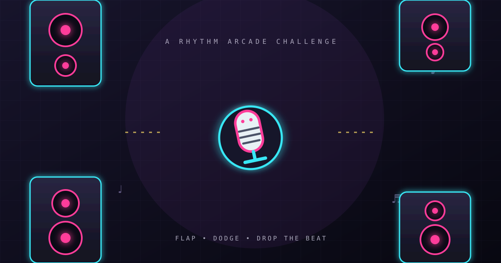

<div align="center">
  
  <h1>Flappy Beat Drop</h1>
  <p><strong>Flap. Dodge. Drop the beat.</strong></p>
  <p>A neon rhythm-inspired arcade game made for quick browser sessions on desktop and mobile.</p>
  <p>
    <a href="https://golden-elf-10a0d8.netlify.app/"><strong>▶ Play the live demo</strong></a>
    &nbsp;·&nbsp;
    <a href="https://github.com/khan018134/flappy-beat-drop">View source</a>
  </p>
</div>

## About

Take control of a musical character and weave through glowing speaker stacks. Collect vinyl, build score combos, and use power-ups to keep your run alive. The game is a lightweight static site built with vanilla JavaScript and the Canvas API—no install or build step required.

## Features

- Three character skins: MC Mic, Boombox, and Grillz
- Responsive canvas rendering with neon city-inspired visuals
- Endless obstacle course with gradually increasing challenge
- Combo scoring with multipliers up to 4×
- Vinyl bonus pickups, protective Shield, and temporary Slow-Mo
- Synthesized sound effects using the Web Audio API, with a mute toggle
- Personal best saved locally in the browser
- Pause and resume, including automatic pause when the page is hidden
- Mobile touch, desktop click, and keyboard controls

## How to play

| Action | Control |
| --- | --- |
| Flap / start | Tap or click the game canvas; press **Space** on desktop |
| Pause / resume | **Esc** or **P**, or use the pause button |
| Toggle sound | Use the sound button in the header |

Fly through each speaker gap without hitting an obstacle or the stage boundary. Clearing obstacles builds your combo; pickups add points or temporary abilities.

## Run locally

No dependencies or build tools are needed. Open `index.html` in a modern browser, or serve the project folder locally:

```bash
python -m http.server 8000
```

Then visit <http://localhost:8000>.

## Deploy

This is a static website. Deploy the repository root with GitHub Pages, Netlify, Vercel, or another static host. The site entry point is `index.html`.

The game itself has no runtime package dependencies. Google Fonts is loaded remotely for typography; the game remains playable if that request is unavailable. Sound is generated in the browser and may require a user gesture before it starts.

## Built with

- HTML5 and CSS
- Vanilla JavaScript and Canvas API
- Web Audio API
- Google Fonts (Space Grotesk and DM Mono)

## Project layout

```text
.
├── assets/
│   └── cover.svg     # Repository banner artwork
├── favicon.svg       # Browser tab icon
├── index.html        # Game, styles, and logic
├── README.md
└── .gitignore
```

## License

No license has been specified. All rights are reserved by default; please contact the repository owner before reusing or redistributing this project.
